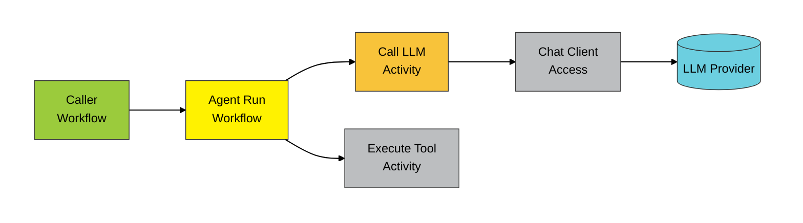

# 

[](https://www.nuget.org/packages/Diagrid.AI.Microsoft.AgentFramework)

Diagrid.AI.Microsoft.AgentFramework is a library that facilitates building agents using Microsoft's Agent Framework atop Dapr's Durable Workflows.

## Register Agents with dependency injection

### Simple DI registration
The following shows the simple dependency injection registration of MAF agents:

```csharp
var builder = WebApplication.CreateBuilder(args);

// Register agents to run within 
builder.Services.AddDaprAgents()
    .WithAgent(
        agentName: "SampleAgent",
        conversationComponentName: "conversation-ollama",
        instructions: "You are a helpful assistant. Answer normally unless the prompt asks for JSON.",
        serviceLifetime: ServiceLifetime.Singleton);

var app = builder.Build();
```

### Register Agents with typed deserialization contexts
The following elaborates to show how agent responses can be coerced into typed and deserialized JSON responses: 

```csharp
// Register the record that the result will be deserialized into
public sealed record StructuredAnswer(string Answer, double Confidence);

// Register the context used to deserialize the result - additional types need only be added with more `JsonSerializable` attributes
[JsonSourceGenerationOptions(PropertyNamingPolicy = JsonKnownNamingPolicy.CamelCase)]
[JsonSerializable(typeof(StructuredAnswer))]
public partial class AgentInvokerJsonContext : JsonSerializerContext;

// Program startup
var builder = WebApplication.CreateBuilder(args);
builder.Services.AddDaprAgents(serializationOptions => 
{
    serializationOptions.AddContext(() => AgentInvokerJsonContext.Default);
}).WithAgent(
    agentName: "SampleAgent",
    conversationComponentName: "conversation-ollama",
    instructions: "You are a helpful assistant. Answer normally unless the prompt asks for JSON.",
    serviceLifetime: ServiceLifetime.Singleton);

var app = builder.Build();
```

### Register Agents alongside Dapr Workflows
The following shows how Dapr Workflows can be registered alongside agent registrations:

```csharp
// Register the record that the result will be deserialized into
public sealed record StructuredAnswer(string Answer, double Confidence);

// Register the context used to deserialize the result - additional types need only be added with more `JsonSerializable` attributes
[JsonSourceGenerationOptions(PropertyNamingPolicy = JsonKnownNamingPolicy.CamelCase)]
[JsonSerializable(typeof(StructuredAnswer))]
public partial class AgentInvokerJsonContext : JsonSerializerContext;

var builder = WebApplication.CreateBuilder(args);
builder.Services.AddDaprAgents(serializationOptions => 
{
    serializationOptions.AddContext(() => AgentInvokerJsonContext.Default); // Necessary to deserialize the workflow results to strongly typed values
}, workflowOptions => 
{
    workflowOptions.RegisterWorkflow<SampleWorkflow>(); // Register workflow types normally here
}).WithAgent(
    agentName: "SampleAgent",
    conversationComponentName: "conversation-ollama",
    instructions: "You are a helpful assistant. Answer normally unless the prompt asks for JSON.",
    serviceLifetime: ServiceLifetime.Singleton);

var app = builder.Build();
```

## Using Agents
Agents can be invoked in a variety of ways. The following examples show the most common approaches.

### Via `IDaprAgentInvoker` injection
In this example, the `IDaprAgentInvoker` is registered via any of the above approaches with dependency injection and is used to provision an instance of the named agent.
```csharp
public sealed record AskRequest(string Prompt);
app.MapPost("/ask", async (IDaprAgentInvoker invoker, AskRequest request, CancellationToken ct = default) => 
{
    var agent = invoker.GetAgent("SampleAgent"); // Retrieves the instance of the registered agent
    var response = await invoker.RunAgentAsync(agent, request.Prompt, cancellationToken: ct);
    return Results.Ok(new { response = response.Text });
});
```

### Within Dapr Workflow context
In this example, we access an instance of a registered Agent from within a Dapr Workflow context.
```csharp
public sealed partial class SampleWorkflow : Workflow<string, string>
{
    public override async Task<string> RunAsync(WorkflowContext context, string input)
    {
        var logger = context.CreateReplaySafeLogger(nameof(SampleWorkflow));
        var agent = context.GetAgent("SampleAgent"); // Retrieves the instance of the registered agent
        var result = await context.RunAgentAndDeserializeAsync<StructuredAnswer>(
            agent: agent,
            message: $"Analyze and return JSON: {{\"answer\": string, \"confidence\": number}}\n{input}",
            logger: logger)
            .ConfigureAwait(false); // Runs the agent invocation as a Dapr workflow and returns the strongly-typed result
        // ...
    }
}
```

### Detached agent runs
`StartAgentRunDetachedAsync` starts an agent run from a workflow without waiting for it, and
returns the run's instance ID. The run is independent of the calling workflow: a failed run does
not fail the caller, and terminating the caller does not terminate the run. Use it for
fire-and-forget work such as notifications or follow-ups.

```csharp
public sealed class OrderWorkflow : Workflow<Order, string>
{
    public override async Task<string> RunAsync(WorkflowContext context, Order order)
    {
        // ... the order work the caller waits for ...
        var runId = await context.StartAgentRunDetachedAsync(
            context.GetAgent("NotifierAgent"),
            message: $"Tell the customer order {order.Id} has shipped.");
        return runId;
    }
}
```

The run's `AgentRunResult` is its workflow output, readable through `DaprWorkflowClient` with
the returned ID. Detached runs need a **Dapr 1.19 or newer sidecar**; an older one retries the
unknown action indefinitely, so the calling workflow stalls.

## Large payloads in a binary store
Every agent turn carries the whole conversation between activities, and each of those payloads is
written to the workflow history. With Dapr 1.19, payloads above a threshold (64 KiB by default) can
live in a binary store instead, with only a reference in the history. The SDK uploads and resolves
them for you, so your workflows and agents do not change:

```csharp
builder.Services.AddDaprAgents()
    .WithAgent(/* ... */)
    .WithBinaryStorePayloads("agent-payloads", options =>
    {
        options.OffloadThreshold = 128 * 1024; // optional; 64 KiB by default
    });
```

`agent-payloads` is a Dapr binary store component, for example:

```yaml
apiVersion: dapr.io/v1alpha1
kind: Component
metadata:
  name: agent-payloads
spec:
  type: binarystore.aws.s3   # or azure.blobstorage, gcp.bucket, oci.objectstorage; in-memory for local tests
  version: v1
  metadata: [] # store-specific settings
```

> This needs a **Dapr 1.19 or newer sidecar**, and the store must outlive the workflows that reference
> it. `binarystore.in-memory` loses its payloads when the sidecar restarts, after which a replaying
> workflow cannot resolve them, so use it only for local testing. Register `WithBinaryStorePayloads`
> in every app that hosts or schedules these workflows.

## Conversation store
`WithConversationStore` keeps conversation history, including the model's reasoning, in a Dapr state
store, outside the workflow payloads:

```csharp
builder.Services.AddDaprAgents()
    .WithAgent(/* ... */)
    .WithConversationStore("statestore", options =>
    {
        options.TimeToLive = TimeSpan.FromDays(14); // optional, recommended
    });
```

It registers `IConversationStore`, which loads a conversation's history and appends one run's
messages to it as a turn (the agent runs below use it for you):

- **A turn is stored all at once or not at all.** Its messages are written first, then a small
  manifest is committed with an ETag check, so a reader never sees half a turn.
- **Appending the same turn id again changes nothing**, and returns `AlreadyAppended`. Retrying an
  append after a timeout is therefore safe.
- **Concurrent appends to one conversation are ordered by commit.** A turn produced without
  seeing an earlier commit is still stored, and its result reports `BaseMoved`.
- **`LoadAsync(id, upToSequence, incarnation)` returns a fixed prefix** that later appends do not
  change. It throws `ConversationNotFoundException` if that prefix was deleted or expired, rather than
  returning less, or another conversation created since under the same id.
- **`DeleteAsync` leaves a small tombstone** at the conversation's key, so an append still in flight
  cannot bring back history that was deleted. An append to the same id after that starts a new
  conversation.

| Setting | Default | Meaning |
|---|---|---|
| `KeyPrefix` | `agent-conversation:` | Prefix of every key, after the component's own key prefix (the app id by default) |
| `TimeToLive` | none | A conversation expires this long after it was last written. A read after half of it renews it, but a single pause longer than the TTL still loses the history, so size it for the longest pause |
| `MaxChunkBytes` | 256 KiB | Size of each stored document of messages; keep it below the store's value limit |
| `TurnDedupeWindow` | 128 | How many recent turn ids are remembered for idempotent appends |
| `MaxCommitAttempts` | 10 | Commit attempts under contention before `ConversationStoreException` |

The component must support ETags, and TTL if you set one; Redis, PostgreSQL and Cosmos DB, for
example, support both. Keys are prefixed, so the workflow `statestore` works. Set the expiry with
`TimeToLive`, not with `ttlInSeconds` on the component: a component-wide TTL would also expire stored
messages that a conversation still references.

> An append whose outcome cannot be confirmed (a lost reply) can leave unreferenced documents
> behind. They are deleted once they provably cannot become part of the conversation; otherwise the
> TTL removes them, so setting one is recommended.

### Running agents against a stored conversation
Inside a workflow, `RunAgentInConversationAsync` runs the agent on everything already committed to the
conversation, its own earlier reasoning included, and appends the run as one turn if it succeeds:

```csharp
var planner = context.GetAgent("Planner");
var conversationId = $"{context.InstanceId}/planning"; // deterministic: never Guid.NewGuid() in a workflow

var first = await context.RunAgentInConversationAsync(planner, conversationId, "Draft a plan.");
var second = await context.RunAgentInConversationAsync(planner, conversationId, "Now shorten it.");

await context.DeleteConversationAsync(conversationId); // or rely on TimeToLive
```

Outside a workflow, attach a session to the conversation and run agents through the invoker:

```csharp
var session = invoker.AttachConversation("customer-42");
await invoker.RunAgentAsync(agent, "Hi, I need help with my order.", session);
await invoker.RunAgentAsync(agent, "It arrived damaged.", session); // sees the first turn
```

Session workflows can keep their conversation in the store too, so no growing log is sent with every
turn. `CreateStoredSessionAsync` creates one:

```csharp
var session = await invoker.CreateStoredSessionAsync(workflowClient, new DaprSessionOptions { MaxTurns = 50 });

// Keep both ids to reattach later: AttachSession(instanceId, conversationId).
var instanceId = session.GetSessionInstanceId();
var conversationId = session.GetConversationId();

// After that session reached MaxTurns, continue the same conversation in a new one:
var next = await invoker.CreateStoredSessionAsync(workflowClient,
    new DaprSessionOptions { ConversationId = conversationId });
```

- **The history does not travel in workflow payloads.** Each LLM call loads it from the store, pinned to
  what the run's first call saw, so every call of a run sees the same history.
- **A failed run appends nothing**, so retrying it with the same conversation id is safe.
- **A run that hits its iteration limit appends its messages too**, ending with the tool results, as
  `TurnMessages` returns them.
- **Reasoning follows `WithReasoningReplay`.** It is stored and sent back only to the agent and chat
  client that produced it, and not stored at all with `WithinRun` or `Off`.
- A run takes its history from a conversation or from `RunAgentWithHistoryAsync`'s prior messages, not
  both. Runs without a conversation id work exactly as before.

### Context window and compaction
A long conversation eventually outgrows the model's context window. Two settings handle it:

```csharp
builder.Services.AddDaprAgents()
    .WithAgent(/* ... */)
    .WithConversationStore("statestore")
    // What each LLM call sends is fitted to the model: 128k window, 8k kept for the reply.
    .WithContextWindow("Planner", maxContextTokens: 128_000, maxOutputTokens: 8_000)
    // Older turns are summarized once the loaded history passes 60k tokens; the last 4 stay word for word.
    .WithConversationCompaction("Planner", options =>
    {
        options.TriggerTokens = 60_000;
        options.KeepRecentTurns = 4;
    });
```

- **`WithContextWindow`** changes only what one LLM call sends; nothing stored changes.
  - When what would be sent is larger than the window less the room kept for the reply, it leaves out
    earlier turns, **whole and oldest first**, until it fits. A turn starts at a user message, so the
    history sent never opens with an assistant message or a tool result, and a tool call always travels
    with its results. A stored summary counts as a turn.
  - The instructions, the context providers' messages, system messages in the history other than a
    stored summary (a persona you pass in, for example) and **the run's own messages are always sent**:
    dropping them would lose the task, its context or the reasoning a tool loop needs. When those alone
    do not fit, the LLM call fails, and with it the run, with an error saying the context window was
    exceeded, instead of reaching a model that would reject the request or silently cut it.
  - It works with any history, stored or passed in. Tokens are estimated as characters / 4 over the
    messages as they are sent, so reasoning that is not sent back does not count.
- **`WithConversationCompaction`** keeps a stored conversation's meaning instead of dropping it:
  - **When it runs:** after a run whose loaded history was past `TriggerTokens`, right after the run's
    turn is stored and before the run returns, so that run's response waits for the summary call.
  - **What it summarizes:** the oldest turns that fit `MaxSummaryInputTokens` (by default
    `TriggerTokens`), together with the earlier summary. It keeps up to `KeepRecentTurns` recent turns
    word for word, fewer if they add up to more than half the trigger, and always the latest. Turns that
    do not fit are summarized by later runs. It uses the agent's own chat client and options, or
    `options.ChatClient`.
  - **Where the summary goes:** it is appended to the conversation, and later runs load it in place of
    those turns. The original messages stay stored (`LoadEntriesAsync` reads them all), and a run already
    in progress keeps the history it started with.
  - **Cost:** the summary is computed once and stored, not on every call.
  - **On failure:** compaction is best effort. If the summary call fails, the run still succeeds and the
    next run tries again.

Set both, with `TriggerTokens` well below the window: compaction keeps the conversation short, and the
window is the safety net for a single run that grows too large.

## Model reasoning
When the chat client returns the model's reasoning as `TextReasoningContent` (reasoning models
such as OpenAI's Responses API, Anthropic extended thinking, or DeepSeek-style
`reasoning_content`), the agent keeps it:

- The reasoning stays on the assistant message it came with and is sent back to the model on
  the next LLM call of the run. Providers such as Anthropic require the reasoning, and its
  signature (`ProtectedData`), that preceded a tool call to accompany the tool result.
- `AgentRunResult.TurnMessages` carries it (`WorkflowChatMessage.Reasoning`), so passing those
  messages back as history continues from the earlier reasoning instead of starting from zero:

```csharp
var first = await context.RunAgentWithHistoryAsync(agent, "Plan the migration.");
var second = await context.RunAgentWithHistoryAsync(agent, "Now estimate it.", first.TurnMessages);
```

- The response of a run started from a workflow or with `RunAsync` starts with the final
  reasoning, followed by the text. `AgentResponse.Text` is unchanged, because it concatenates only
  text content. A session turn returns the text only, but its reasoning stays in the session
  history and is sent back on later turns.

How the reasoning moves through a run, as an IDesign call chain:



1. The caller workflow runs the agent with the previous turn's `TurnMessages` as history.
2. The agent run workflow calls the **Call LLM activity** once per loop iteration, with the
   run's messages so far.
3. The activity converts the messages for the chat client. It puts back, first in each
   message, the reasoning whose `Source` is this agent and chat client key, and leaves out the
   rest.
4. The **chat client** calls the model, which returns text, tool calls and reasoning.
5. The activity captures the reasoning, records its `Source`, and returns it with the text and
   tool calls.
6. The workflow keeps the reasoning on the assistant message. When the model asked for tools,
   the **Execute Tool activity** runs each one and the loop goes back to step 2, so the next
   call sees the reasoning behind its tool calls.
7. When the model answers, the run returns its `AgentRunResult`: the `Response` starts with the
   final reasoning, and `TurnMessages` carries every block, ready for the next turn's step 1.

Reasoning goes back only to the agent that produced it (same agent name and chat client key),
because a provider rejects another provider's signed or encrypted reasoning. History passed to a
different agent keeps its text, tool calls and results, without the reasoning. Blocks that cannot
be rebuilt faithfully are returned to the caller but not sent back: blocks with no text, such as
Anthropic `redacted_thinking`, and OpenAI Responses reasoning items, whose `rs_…` id does not
survive the workflow (rely on the Responses API's own conversation state for those).

`AIContextProvider`s do not see the reasoning, so they receive the same messages as before.
Clients that do not return reasoning are unaffected; the Dapr Conversation API does not carry
it today.

### Reasoning effort
Ask a reasoning model for an effort level with `WithReasoning`, for every agent or for one. It is
sent as `ChatOptions.Reasoning` on every LLM call:

```csharp
builder.Services.AddDaprAgents()
    .WithAgent(/* ... */)
    .WithReasoning(ReasoningEffort.Medium)                           // every agent
    .WithReasoning("Planner", ReasoningEffort.High, ReasoningOutput.Full); // this agent only
```

An agent created with its own `ChatClientAgentOptions.ChatOptions` now keeps them on every LLM
call; earlier versions used only their tools. That covers temperature, output limits, response
format, tool mode, additional properties, reasoning and the rest, with these exceptions:

- Tools, instructions and the conversation id are supplied by the run itself.
- Background responses and continuation tokens apply only when a run's `AgentRunOptions` set them,
  because the workflow does not poll a background response.
- A required tool mode (`ChatToolMode.RequireAny` or `RequireSpecific`) applies to the run's first
  LLM call only, as with `FunctionInvokingChatClient`; otherwise a model that obeys it would call
  tools until the run hits its iteration limit.

A run's `AgentRunOptions` override only what they set, so an agent's own response format also
applies to `RunAgentAndDeserializeAsync<T>` unless the run passes one. With `DaprChatClient`, the
tool mode is sent as the Conversation API's tool choice and additional properties as its metadata.

The effort and the output are each taken from `WithReasoning(agentName, ...)`, else the agent's
own `ChatOptions.Reasoning`, else `WithReasoning(...)` for every agent.

Chat clients that do not support reasoning options ignore the effort. `DaprChatClient` is one of
them, because the Dapr Conversation API has no field for it; an agent that sets an effort on it
logs a warning once.

### Sending reasoning back
Sending reasoning back costs input tokens on every call, and keeping it makes the run's messages,
and the workflow payloads that carry them, larger. `WithReasoningReplay` chooses how much, for
every agent or for one:

| `ReasoningReplay` | Sent back | Kept in `TurnMessages` |
|---|---|---|
| `AcrossTurns` (default) | on the run's later calls, and on later turns given the history | yes |
| `WithinRun` | only on the later calls of the run that produced it, as a tool loop needs | no |
| `Off` | never | no |

With `WithinRun` and `Off`, reasoning in the history from earlier turns is also dropped from the
run's later LLM call inputs. Use `WithinRun`, not `Off`, with providers that require the reasoning
behind a tool call to accompany the tool result, such as Anthropic extended thinking.

```csharp
builder.Services.AddDaprAgents()
    .WithAgent(/* ... */)
    .WithReasoningReplay("Engineer", ReasoningReplay.WithinRun);
```

With every setting, the response returned to the caller still starts with the final reasoning.

## LLM call timeouts
Each LLM call is bounded by a timeout, 100 seconds unless you change it. A slow model, such as one
running locally, can need more. Set a default for every agent, override it per agent, or pass
`Timeout.InfiniteTimeSpan` to disable it:

```csharp
builder.Services.AddDaprAgents()
    .WithAgent(
        agentName: "SampleAgent",
        conversationComponentName: "conversation-ollama",
        instructions: "You are a helpful assistant.")
    .WithLlmTimeout(TimeSpan.FromMinutes(3))                  // every agent
    .WithLlmTimeout("SampleAgent", TimeSpan.FromMinutes(10)); // this agent only
```

The timeout applies to one LLM call, not to a whole agent run. A call that exceeds it fails its
activity with a `TimeoutException` naming the agent.

> `AddDaprAgents()` registers the Dapr Conversation client itself, without the 100-second
> `HttpClient` cap. If you register your own with `AddDaprConversationClient(...)` *before*
> `AddDaprAgents()`, yours is kept, and its `HttpClient.Timeout` (100 seconds by default) still
> applies on top of `WithLlmTimeout`, so set it with `UseTimeout(...)` as well.

## Skills
Skills are portable packages of instructions, reference material, and scripts that give an agent
domain-specific expertise at runtime — complementary to Tools. They're discovered via a skills
provider, advertised by name and description only in the agent's system prompt, and loaded on demand
through `load_skill`/`read_skill_resource`/`run_skill_script` tool calls, keeping full skill content
out of every prompt until the agent actually needs it.

> Skills build on MAF's `AgentSkill`/`AgentSkillsProvider` APIs, which are marked
> `[Experimental("MAAI001")]` upstream (evaluation purposes only) — `WithSkills(...)` carries the same
> marker.

### Registering skills
Skills can be sourced three ways — file-based, inline, and class-based — mixed freely on the same
agent via `AgentSkillsProviderBuilder`:

```csharp
// Resolve file skills against the build output, which is where the csproj's
// <Content Include="skills\**\*" CopyToOutputDirectory="PreserveNewest" /> item puts them.
var skillPath = Path.Combine(AppContext.BaseDirectory, "skills", "unit-converter");

builder.Services.AddDaprAgents()
    .WithAgent(
        agentName: "SkillsAgent",
        conversationComponentName: "conversation-ollama",
        instructions: "You are a helpful assistant.",
        serviceLifetime: ServiceLifetime.Singleton)
    .WithSkills("SkillsAgent", skills => skills
        // File-based: discovered from SKILL.md. MAF requires a script runner whenever any
        // file-based source is configured, even if that skill defines no scripts itself.
        .UseFileSkill(skillPath, scriptRunner: (_, _, _, _, _) =>
            throw new NotSupportedException("The unit-converter skill has no scripts."))
        .UseSkill(new AgentInlineSkill(                       // Inline: defined directly in code
            name: "joke-teller",
            description: "Tells a short, work-appropriate joke on request.",
            instructions: "When asked for a joke, tell exactly one short, clean joke."))
        .UseSkill(new GreetingSkill())                        // Class-based: AgentClassSkill<T>
        .UseScriptApproval());                                // Require approval before running scripts

var app = builder.Build();
```

A single skill (or a plain list) can also be attached directly, without the builder:
```csharp
builder.Services.AddDaprAgents()
    .WithSkills("SkillsAgent", new AgentInlineSkill(name: "...", description: "...", instructions: "..."));
```

Any `AIContextProvider` — not just skills — can be attached to an agent the same way, via
`WithContextProviders(...)`.

### Script approval
Skill-bundled scripts can require human approval before they run
(`AgentSkillsProviderBuilder.UseScriptApproval()`). Implement `IToolApprovalHandler` and register it
*before* calling `AddDaprAgents()` to decide whether a given call is allowed to proceed — without one
registered, every approval-required call is denied by default:

```csharp
public sealed class SlackApprovalHandler : IToolApprovalHandler
{
    public async Task<ToolApprovalDecision> RequestApprovalAsync(ToolApprovalRequest request, CancellationToken ct = default)
    {
        // Runs inside a Dapr Workflow *activity*, so it's safe to await a real decision here —
        // e.g. post to Slack and poll a data store the response updates out of band.
        var approved = await AwaitHumanDecisionAsync(request, ct);
        return approved ? ToolApprovalDecision.Approve() : ToolApprovalDecision.Deny("Declined in Slack.");
    }
}

builder.Services.AddSingleton<IToolApprovalHandler, SlackApprovalHandler>();
builder.Services.AddDaprAgents() /* ... */;
```

See [`examples/SkillsDemo`](https://github.com/diagridio/dotnet-ai/tree/master/examples/SkillsDemo) for
a complete, runnable example covering all three discovery mechanisms plus script approval.

## Usage analytics

`AddDaprAgents()` reports one anonymous usage event the first time it's called, once per
package per process. NuGet publishes aggregate download counts only, so this is how Diagrid
sees which package versions run on which platforms. Because it is one event per process, a
Kubernetes deployment produces one event per replica per restart: the numbers count process
starts, not deployments or users.

**What is sent:** the package name and version, operating system, architecture, the .NET
runtime version, the agent framework and the installed version of its library (`framework`,
`framework_version`), `kind=agent`, whether the process points at Catalyst or at a plain Dapr
sidecar (`target`), and whether it runs under a CI variable (`ci`). Nothing else: no
application data, configuration, app IDs, prompts, or hostnames. The receiving service is
[Scarf](https://scarf.sh). It derives coarse company and location information from the request
IP. How Scarf handles that data is described in
[Scarf's privacy policy](https://about.scarf.sh/privacy-policy).

**It never gets in the way:** the request runs on a background task with a one second HTTP
timeout, every failure is swallowed, and the caller never waits. Blocked egress and air-gapped
clusters behave normally. Nothing is written to your application's output — there is no
logger to configure for it either.

To opt out, set any of these environment variables before starting your application:

```bash
export DO_NOT_TRACK=1
# or
export SCARF_NO_ANALYTICS=1
# or
export DIAGRID_NO_ANALYTICS=1
```

## Identity

`Diagrid.AI.Identity` verifies the inbound Catalyst user token on every request and carries it
on outbound on-behalf-of calls. Two lines install it:

> The whole surface is marked `[Experimental("DGRDID001")]`, so it may change outside a major
> release. Suppress the diagnostic to opt in:
> `<NoWarn>$(NoWarn);DGRDID001</NoWarn>`.

```csharp
builder.Services.AddDiagridIdentity(cfg => cfg.Scopes = ["agent.invoke"]);
app.UseDiagridIdentity();

app.MapGet("/whoami", (HttpContext ctx) => Results.Ok(ctx.GetVerifiedUser()!.Subject));
```

A third registers the client outbound calls go out on. It is a plain `HttpClient` from
`IHttpClientFactory`, so it goes anywhere one goes, and it reads the caller's token at send
time rather than when the client is built:

```csharp
builder.Services.AddDiagridIdentityHttpClient();
```

### Discovery precedence

The issuer, audience and JWKS endpoint come from four sources, highest precedence first:

1. **Explicit configuration** — `cfg.Issuer`, `cfg.Audience`, `cfg.JwksUri`.
2. **The local sidecar's `/v1.0/metadata`** — probed at `http://127.0.0.1:$DAPR_HTTP_PORT`
   (or `$CATALYST_DAPR_HTTP_PORT`). Asked before the remote one: a deployed in-cluster app
   keeps its loopback call rather than paying for a network round trip.
3. **The remote sidecar's `/v1.0/metadata`** — probed at `$DAPR_HTTP_ENDPOINT`, authenticated
   with `$DAPR_API_TOKEN` when set. This is the source `diagrid dev run` supplies.
4. **Environment variables** — `DIAGRID_DP_SENTRY_ISSUER` and `DIAGRID_DP_SENTRY_AUDIENCE`.

The JWKS endpoint itself resolves explicit first, then the value the sidecar advertised when
its issuer is the one that resolved, then `issuer + /jwks.json`. If no source supplies an
issuer, every token-carrying request is refused with 503 `oauth.not_configured`.

`cfg.AllowInsecureJwks = true` accepts a non-loopback plaintext `http://` JWKS endpoint. It
relaxes plain HTTP only — `file://` and every other scheme stay refused — and it is a
local-development escape hatch: signing keys fetched over plaintext can be substituted by
anyone on the path, which gives up the guarantee that a verified token was signed by
dp-Sentry. Loopback endpoints are exempt without it.

`cfg.RequireAuth` governs the no-token case only. When `true` (the default) a request with no
`X-Diagrid-User-Token` is refused with 401 `oauth.missing_token`; when `false` it reaches the
handler and `GetVerifiedUser()` returns `null`. Either way a token that **is** present is
always verified, and an invalid one is always refused.

### Status and error codes

Every rejection is `{"error":"<code>"}` with `Cache-Control: no-store`.

| Status | Code | When |
| --- | --- | --- |
| 401 | `oauth.missing_token` | No `X-Diagrid-User-Token` header and `RequireAuth` is on |
| 401 | `oauth.decode_error` | The token is not a well-formed JWT |
| 401 | `oauth.invalid_signature` | The signature did not verify against the key set |
| 401 | `oauth.expired` | The token's `exp` has passed (120s clock skew allowed) |
| 401 | `oauth.invalid_issuer` | The token's `iss` does not match the resolved issuer |
| 401 | `oauth.invalid_audience` | The token's `aud` does not match the resolved audience |
| 401 | `oauth.invalid_token` | Any other claim failure — a missing `exp`/`iss`/`sub`, or a disallowed `alg` |
| 403 | `oauth.missing_scope` | The verified token lacks a scope the route requires |
| 503 | `oauth.not_configured` | No source supplied identity coordinates, or the JWKS endpoint is unusable |
| 503 | `oauth.verifier_unavailable` | Key material is not loaded yet, or no key matches the token's `kid` |

Claim checks run in one order across every Diagrid SDK — required claims, then `exp`, then
`iss`, then `aud` — so a token with two defects yields the same code wherever it is sent.

See [`examples/IdentityDemo`](https://github.com/diagridio/dotnet-ai/tree/master/examples/IdentityDemo)
for a complete, runnable example.

## Links
- [Diagrid](https://diagrid.io/)
- [Diagrid Documentation](https://docs.diagrid.io/)
- [NuGet Package](https://www.nuget.org/packages/Diagrid.AI.Microsoft.AgentFramework)
- [License](https://github.com/diagridio/dotnet-ai/blob/master/LICENSE.md)